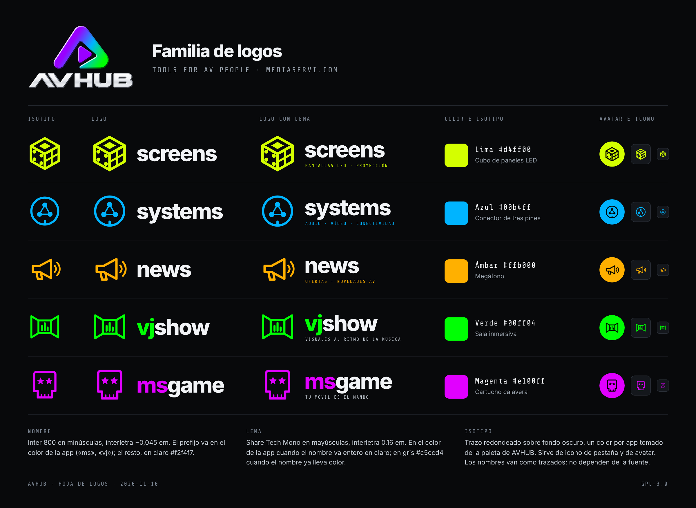

# AVHUB
AVHUB is your assessor for AV projects in an easy, helpful, and handy APP.

## Icono

Icono de pestaña y de app (noviembre 2026) en el estilo de placa de la familia: placa con degradado negro a morado, filete negro y sombra verde, con la A del play. Ficheros: `assets/logos/avhub-icono.svg`, `assets/logos/avhub-icono-180.png` y `assets/iconos/avhub-192/512/maskable-512.png`.

## Logos de la familia

Cada sección de AVHUB tiene su isotipo, su color y su nombre en la misma letra. Los archivos están en `assets/logos/`.

| Sección | Isotipo | Color | Archivos |
|---|---|---|---|
| SCREENS | Cubo de paneles LED | Lima `#d4ff00` | `screens-icono.svg`, `screens-logo.svg`, `screens-logo-lema.svg` |
| SYSTEMS | Conector de tres pines | Azul `#00b4ff` | `systems-icono.svg`, `systems-logo.svg`, `systems-logo-lema.svg` |
| ADPOSTER | Caballete con cartel | Ámbar `#ffb000` | `adposter-icono.svg`, `adposter-logo.svg`, `adposter-logo-lema.svg` |
| VJSHOW | Sala inmersiva | Verde `#00ff04` | `vjshow-icono.svg`, `vjshow-logo.svg`, `vjshow-logo-lema.svg` |
| MSGAME | Calavera que guiña con una cruceta | Magenta `#e100ff` | `msgame-icono.svg`, `msgame-logo.svg`, `msgame-logo-lema.svg` |

- **Nombre:** Inter 800 en minúsculas, interletra −0,045 em. El prefijo va en el color de la app («ms», «vj»); el resto, en claro `#f2f4f7`.
- **MSGAME** lleva logotipo propio: «MS» en dos fichas moradas con la misma letra que GAME y sombra verde.
- **Lema:** Share Tech Mono en mayúsculas, interletra 0,16 em.
- **Isotipo:** trazo redondeado sobre fondo oscuro; sirve de icono de pestaña y de avatar.
- Los nombres van convertidos a trazados, así que los SVG no dependen de ninguna fuente. Están pensados para fondo oscuro.
- En la landing, cada equipo del rack lleva su logo grabado en el frontal con los colores serigrafiados, y a su lado el LCD con la explicación.
- **ADPOSTER sustituye a NEWS** en el rack: cartelería digital, con su logo, su enlace y tres displays en vertical en su monitor.
- Al abrir una app desde el rack, la música de la landing se detiene para no pisar la de la app, y vuelve sola al regresar.
- Los rótulos en dos idiomas se quedan 8 s cada uno y cambian con un fundido suave, escalonado y distinto en cada párrafo.
- En el pie: enlace «Aviso legal» (software gratuito hecho por afición, sin garantías; es/en/ca). La portada no lleva botón de instalar ni seta de fallos: cada app se instala por separado desde la suya, y los fallos de la portada los arreglamos nosotros.
- El botón de encendido de cada equipo lo apaga (pantallas, visor, testigos y botón de entrar) y lo vuelve a encender; solo afecta a ese equipo y, apagado, no abre su web. Suena un clic de interruptor cada vez. Ni el apagado ni el encendido son de golpe: al apagar, las pantallas se cierran en una línea y los testigos caen uno a uno; al encender, se ve la barra de arranque en el visor, los testigos vuelven en fila y al final abren las pantallas. La luz ambiente sobre el metal del frontal no cambia: el equipo apagado se ve igual de iluminado.

Eslogan: **TOOLS FOR AV PEOPLE**.

## Sin servidores de terceros para los tipos de letra

La portada lleva sus tipos de letra (Doto, Inter, Share Tech Mono y VT323, todos con licencia OFL) en `assets/fonts/`, así que al abrirla no se pide nada a Google Fonts ni a ninguna otra red de distribución. Licencias en `assets/fonts/LICENCIAS.md`.

## Instalable y sin conexión

Desde el 14-11-2026 la portada no tiene botón «Instalar» ni seta de fallos: cada app de la familia (SCREENS, SYSTEMS, ADPOSTER, VJSHOW y MSGAME) se instala por separado desde su propio botón. Quedan `manifest.json` y `sw.js` (red primero para la página; copia guardada si no hay conexión) para quien ya la tenía instalada; `instalar.js` y `fallo.js` siguen en el repositorio como copia de referencia para las apps.

## Sin caché
Desde el 18-11-2026, las páginas llevan las etiquetas equivalentes a `Cache-Control: no-cache, no-store, must-revalidate` y el service worker pide siempre al servidor, revalidando, sin pasar por la copia del navegador. Sin conexión sigue funcionando con la copia guardada.

## QR (24-11-2026)
Arreglado el QR impreso: `avhub.mediaservi.com/qr` daba ERR_FAILED en móviles con la app ya visitada, porque el service worker entregaba la respuesta redirigida a `/qr/`. Ahora devuelve una redirección limpia y no la guarda; caché renovada (`avhub-v12`).

## Contador y vigilante (24-11-2026)
Contador de visitas activo, anónimo y sin cookies: la portada y el QR mandan al panel AVHUB ADMIN la página, las etiquetas utm y el dominio de procedencia; el panel solo guarda recuentos por día (24 meses). Los escaneos del QR cuentan con fuente «qr». El panel comprueba el QR cada hora y avisa por correo si falla; estado y cifras en su pestaña ANALÍTICA. Además, la tarea «Vigilante del QR» (`.github/workflows/vigia-qr.yml`) abre cada hora el QR en un Chrome real, recién llegado y con la app ya instalada, y manda el resultado al panel; si falla, sale en rojo y GitHub avisa por correo.

## Aviso

Software gratuito y de código abierto, hecho con pasión por un aficionado en su tiempo libre. No es un producto profesional. Se ofrece «tal cual», sin garantías de ningún tipo; los resultados son orientativos y hay que comprobarlos siempre; se usa bajo la responsabilidad de cada cual, hasta donde lo permita la ley aplicable. El aviso completo (es/en/ca) está en la propia app, en el enlace «Aviso legal» que acompaña a la línea de crédito. Licencia GPL-3.0.

Documentos legales del repositorio: [`LEGAL.md`](LEGAL.md) (aviso legal), [`DISCLAIMER.md`](DISCLAIMER.md) (garantías y responsabilidad), [`PRIVACY.md`](PRIVACY.md) (privacidad), [`COOKIES.md`](COOKIES.md) (cookies y almacenamiento local) y [`LICENSE`](LICENSE) (GPL-3.0). Sin publicidad, afiliación ni ingresos de ningún tipo.

## Visibilidad (SEO) y contador anónimo

**24-11-2026 · rama `mk-web`:** título y descripción con «TOOLS FOR AV PEOPLE» y llamada a la acción («Pruébalo gratis»), `canonical`, Open Graph completo (`og:locale` es/en/ca, tamaño y texto alternativo de la imagen 1200×630) y tarjeta de X/Twitter completa; datos estructurados schema.org (JSON-LD: WebSite y una WebApplication gratuita, GPL-3.0, por AVHUB, SCREENS, SYSTEMS, ADPOSTER, VJSHOW y MSGAME); `robots.txt` y `sitemap.xml` nuevos (fuera del índice `mockup/` y `docs/`); logo con prioridad de carga. Sin cambios de diseño.

**Contador de visitas anónimo y sin cookies.** Al final de `index.html` hay un script mínimo que, al abrir la página, manda al panel AVHUB ADMIN (Google Apps Script) solo el sitio, la página, `utm_source`/`utm_campaign`/`utm_content` y el dominio de procedencia. Sin cookies (la petición sale con `credentials: 'omit'`), sin identificadores y sin guardar nada en el navegador; respeta «Do Not Track» y «Global Privacy Control». **Activo desde el 24-11-2026:** el panel solo guarda recuentos por día (24 meses) y los muestra en su pestaña ANALÍTICA. Detalle en [`PRIVACY.md`](PRIVACY.md).

Enlaces de campaña: las etiquetas UTM van solo en los enlaces publicados fuera (LinkedIn, correo, QR impresos), nunca en los enlaces entre mediaservi.com, AVHUB y las apps. Ejemplo: `https://avhub.mediaservi.com/?utm_source=linkedin&utm_campaign=lanzamiento&utm_content=post1`.
