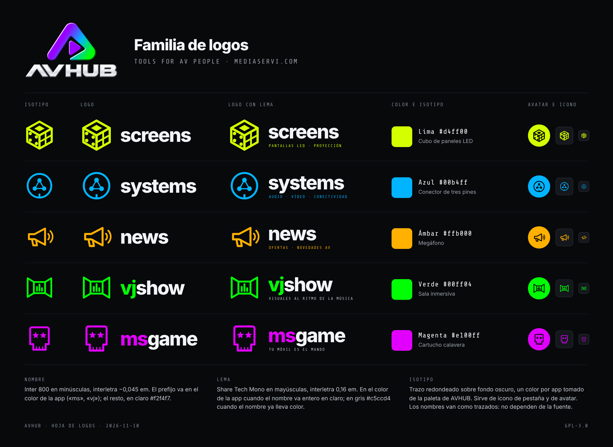

# AVHUB
AVHUB is your assessor for AV projects in an easy, helpful, and handy APP.

## Logos de la familia

Cada sección de AVHUB tiene su isotipo, su color y su nombre en la misma letra. Los archivos están en `assets/logos/`.

| Sección | Isotipo | Color | Archivos |
|---|---|---|---|
| SCREENS | Cubo de paneles LED | Lima `#d4ff00` | `screens-icono.svg`, `screens-logo.svg`, `screens-logo-lema.svg` |
| SYSTEMS | Conector de tres pines | Azul `#00b4ff` | `systems-icono.svg`, `systems-logo.svg`, `systems-logo-lema.svg` |
| ADPOSTER | Caballete con cartel | Ámbar `#ffb000` | `adposter-icono.svg`, `adposter-logo.svg`, `adposter-logo-lema.svg` |
| VJSHOW | Sala inmersiva | Verde `#00ff04` | `vjshow-icono.svg`, `vjshow-logo.svg`, `vjshow-logo-lema.svg` |
| MSGAME | Calavera que guiña con una cruceta | Magenta `#e100ff` | `msgame-icono.svg`, `msgame-logo.svg`, `msgame-logo-lema.svg` |

- **Nombre:** Inter 800 en minúsculas, interletra −0,045 em. El prefijo va en el color de la app («ms», «vj»); el resto, en claro `#f2f4f7`.
- **Lema:** Share Tech Mono en mayúsculas, interletra 0,16 em.
- **Isotipo:** trazo redondeado sobre fondo oscuro; sirve de icono de pestaña y de avatar.
- Los nombres van convertidos a trazados, así que los SVG no dependen de ninguna fuente. Están pensados para fondo oscuro.
- En la landing, cada equipo del rack lleva su logo grabado en el frontal con los colores serigrafiados, y a su lado el LCD con la explicación.
- **ADPOSTER sustituye a NEWS** en el rack: cartelería digital, con su logo, su enlace y tres displays en vertical en su monitor.
- Al abrir una app desde el rack, la música de la landing se detiene para no pisar la de la app, y vuelve sola al regresar.
- Los rótulos en dos idiomas se quedan 8 s cada uno y cambian con un fundido suave, escalonado y distinto en cada párrafo.
- En el pie: enlace «Aviso legal» (software gratuito hecho por afición, sin garantías; es/en/ca) y la seta roja para avisar de un fallo.
- El botón de encendido de cada equipo lo apaga (pantallas, visor, testigos y botón de entrar) y lo vuelve a encender; solo afecta a ese equipo y, apagado, no abre su web. Suena un clic de interruptor cada vez. Ni el apagado ni el encendido son de golpe: al apagar, las pantallas se cierran en una línea y los testigos caen uno a uno; al encender, se ve la barra de arranque en el visor, los testigos vuelven en fila y al final abren las pantallas. La luz ambiente sobre el metal del frontal no cambia: el equipo apagado se ve igual de iluminado.

Eslogan: **TOOLS FOR AV PEOPLE**.

## Sin servidores de terceros para los tipos de letra

La portada lleva sus tipos de letra (Doto, Inter, Share Tech Mono y VT323, todos con licencia OFL) en `assets/fonts/`, así que al abrirla no se pide nada a Google Fonts ni a ninguna otra red de distribución. Licencias en `assets/fonts/LICENCIAS.md`.

## Instalable y sin conexión

La portada es una app web instalable: el botón «Instalar» del pie (junto a la seta) la deja como una app más del móvil, la tableta o el ordenador, y se abre aunque no haya internet con la última copia descargada. Archivos: `manifest.json`, `sw.js` (red primero para la página; copia guardada si no hay conexión; la música de fondo va siempre por la red), `instalar.js` (el botón, común a las apps de AVHUB) e iconos en `assets/iconos/`. Cada app de la familia (SCREENS, SYSTEMS, ADPOSTER, VJSHOW y MSGAME) se instala por separado desde su propio botón.

## Aviso

Software gratuito y de código abierto, hecho con pasión por un aficionado en su tiempo libre. No es un producto profesional. Se ofrece «tal cual», sin garantías de ningún tipo; los resultados son orientativos y hay que comprobarlos siempre; se usa bajo la responsabilidad de cada cual, hasta donde lo permita la ley aplicable. El aviso completo (es/en/ca) está en la propia app, en el enlace «Aviso legal» que acompaña a la línea de crédito. Licencia GPL-3.0.

Documentos legales del repositorio: [`LEGAL.md`](LEGAL.md) (aviso legal), [`DISCLAIMER.md`](DISCLAIMER.md) (garantías y responsabilidad), [`PRIVACY.md`](PRIVACY.md) (privacidad), [`COOKIES.md`](COOKIES.md) (cookies y almacenamiento local) y [`LICENSE`](LICENSE) (GPL-3.0). Sin publicidad, afiliación ni ingresos de ningún tipo.
